# ₹ Spendly — AI-powered personal expense tracker


Spendly is a full-stack expense tracker with an AI assistant you can talk to in **English, Hinglish or Hindi** — by typing or by voice. It adds, edits and deletes expenses from plain sentences, answers questions about your spending, reads receipt photos, forecasts your month-end spend and flags unusual expenses.

It runs **fully locally** with Ollama on your own GPU, or in the **cloud** with Groq — the same code, switched by one setting. It is containerised with Docker and deployed on **AWS EC2**.

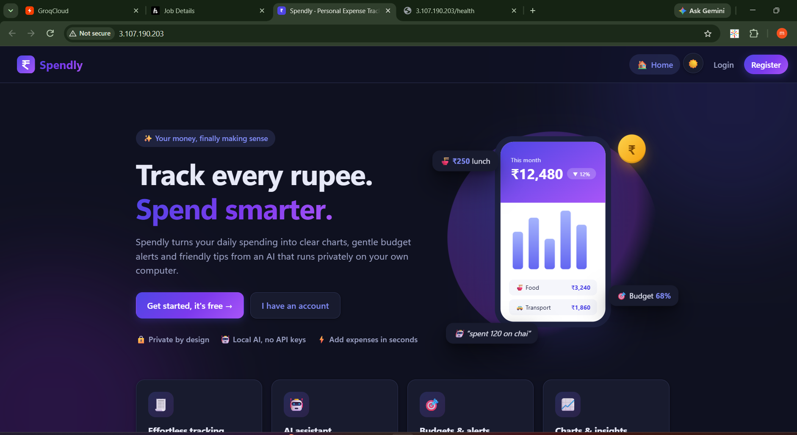

---

## ✨ Features

### Core app
- Accounts with hashed passwords; every user can only see and change their own data
- Expenses and income: add, edit, delete, date filters
- Budgets (overall and per category) with alerts
- Analytics: spending per month, by category, income vs expenses
- Indian-friendly formatting (₹, Indian categories and examples)

### AI assistant (LangChain + LangGraph)
- **Natural language actions:** *"spent 250 on auto and 120 on chai today"* → two previews → you confirm
- **Edits and deletes:** *"the movie was actually 350"*, *"delete the paracetamol expense"*
- **Questions:** *"how much did I spend on food in October?"*, *"what's my savings rate?"*
- **Text-to-SQL** for open questions (*"average weekday food vs weekends?"*), with strict guardrails
- **Conversation memory** with LangGraph — follow-ups like *"what about yesterday?"* work
- **Hindi & Hinglish:** *"kal dhai sau ki dawai li"* → ₹250 · Health · yesterday (number and time words are converted in code)
- **Offline voice input** with faster-whisper (English and Hindi)

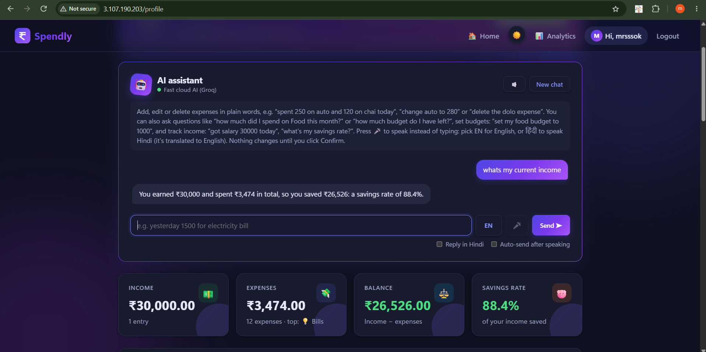

### Computer vision — receipt scanning
- Upload a photo or PDF of any bill: restaurant, pharmacy, utilities, online orders, UPI screenshots
- **OpenCV** cleans the image (resize, grayscale, contrast, sharpen), then a **vision LLM** extracts shop, final amount, date and items
- Picks the *final* amount (Net / Grand Total), not subtotals or tax lines
- Everything is shown in an editable preview before saving

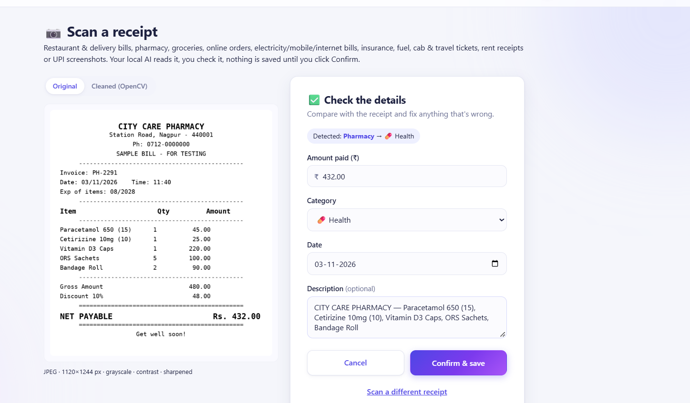

### Machine learning — forecast and anomalies
- **Month-end forecast** with a likely range and "you'll go over budget around 27 Nov" warnings
- **Anomaly detection** (median + MAD) that explains itself: *"₹7,800 is about 14× your typical Health expense"*
- Says "not enough data yet" instead of guessing on small histories

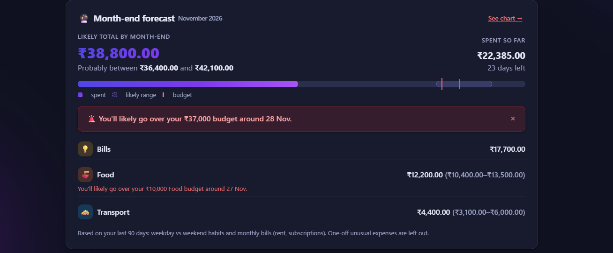

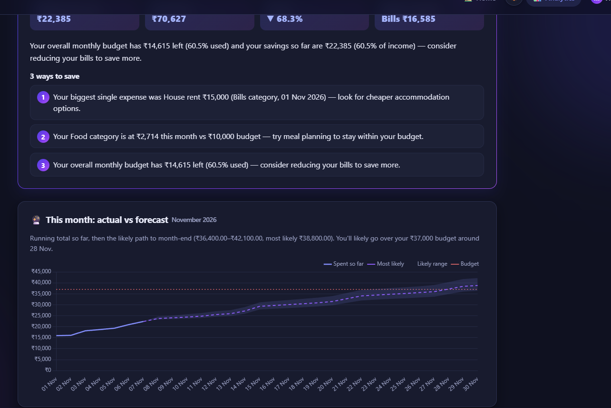

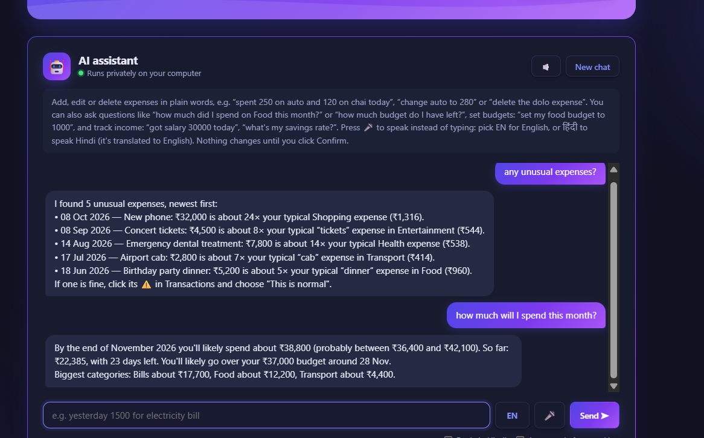

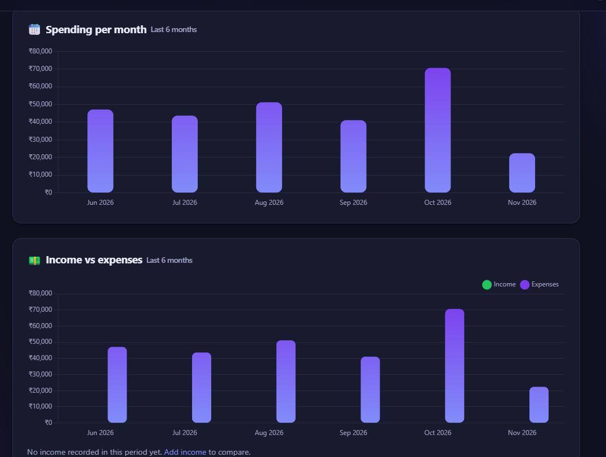

### Integrations
- **MCP server** — Claude (desktop app / Claude Code) can query and add Spendly data as tools

---

## 🛡️ Guardrails ("the AI suggests, code decides")

- The AI **never writes to the database**. Tools only prepare a pending action; nothing changes until the user clicks **Confirm**, and Confirm re-validates everything
- The user always comes from the session — the AI never sees or chooses user IDs or expense IDs
- Negative/zero amounts, off-topic requests and prompt-injection attempts are rejected **in code**, before any model call
- Text-to-SQL runs on a **read-only** connection, against **per-user views**, behind SQLite's **authorizer**, with row and time limits
- Every ₹ number in AI insights must come from computed facts; wrong labels are rejected
- Rate limits and friendly errors when the AI provider is busy or unavailable

---

## 📊 Evaluation and results

**AI evaluation harness** — 113 cases (totals, averages, counts, comparisons, lists, follow-ups, Hinglish, typos, actions, safety, receipts), graded against **ground truth computed with SQL**, run against the real models on a copy of the database.

| Run | Score |
|---|---|
| qwen2.5:7b (local), first run | 79.4% |
| qwen2.5:7b (local), after fixes | **96.4%** (108/112) |
| qwen2.5-coder:7b (local) | 70.5% — weaker tool calling despite being 40% faster |
| gpt-oss-120b (Groq), 5 key groups | **69/69** (actions, counts, safety, Hinglish, totals) |
| Safety cases | **100%** on every model |

**Forecast backtest** (forecast made on day 10 / day 20 of past months vs the real month-end, synthetic data):

| Model | Error from day 10 | Error from day 20 |
|---|---|---|
| **Spendly model** | **9.2%** | **2.3%** |
| Linear regression | 10.6% | 2.4% |
| Naive run-rate | 97.1% | 31.8% |

**Anomaly detection** on 5 injected spikes: median/MAD caught **5/5 with 0 false alarms**; IsolationForest caught 5/5 but raised 70 false alarms.

**Tests:** 900+ pytest tests, also run inside the Docker container and in GitHub Actions CI.

---

## 🧰 Tech stack

| Area | Tools |
|---|---|
| Backend | Python 3.11, Flask, SQLite, gunicorn |
| Frontend | Jinja templates, vanilla JavaScript, CSS, Chart.js (light and dark mode) |
| AI | LangChain, LangGraph, Ollama (qwen2.5:7b, gemma3:4b) or Groq (gpt-oss-120b + a vision model) |
| Voice | faster-whisper (CPU) |
| Vision | OpenCV + vision LLM, PyMuPDF for PDFs |
| ML | scikit-learn, robust statistics (median/MAD) |
| Integrations | MCP (Model Context Protocol) server |
| Testing | pytest, custom eval harness |
| DevOps | Docker, Docker Compose, GitHub Actions CI, AWS EC2 |

---

## 🚀 Running it

### 1. Locally with Ollama (fully private)
```bash
# Windows PowerShell
python -m venv venv
venv\Scripts\Activate.ps1
pip install -r requirements.txt

# Models (once)
ollama pull qwen2.5:7b
ollama pull gemma3:4b

copy .env.example .env      # then fill in SECRET_KEY
python app.py               # http://localhost:5001
```

### 2. With Docker
```bash
docker compose up -d --build     # http://localhost:5001
docker compose logs -f           # view logs
docker compose down              # stop
```
The app talks to Ollama on the host via `host.docker.internal`. The database and the Whisper model cache live in named volumes, so data survives restarts.

### 3. In the cloud (Groq)
Set these in `.env`:
```
LLM_PROVIDER=groq
GROQ_API_KEY=your-key
```
Receipt scanning uses Groq's vision model when available, otherwise it shows a clear "not available" message.

### Demo accounts
- `demo@spendly.com` / `demo123` — a few sample expenses
- `ml_demo@spendly.com` / `demo123` — ~6 months of synthetic data for forecasts and anomalies (`python scripts/seed_ml_demo.py`)

---

## ☁️ Deployment (AWS)

- **EC2** (`c7i-flex.large`, Amazon Linux 2023, Sydney) running the Docker image
- **Groq** as the AI provider (no GPU needed on the server)
- Security group: HTTP open, SSH only from my IP
- New `SECRET_KEY` and `.env` created on the server only — secrets never go into the image or the repo
- The instance is stopped when not in use to save credits

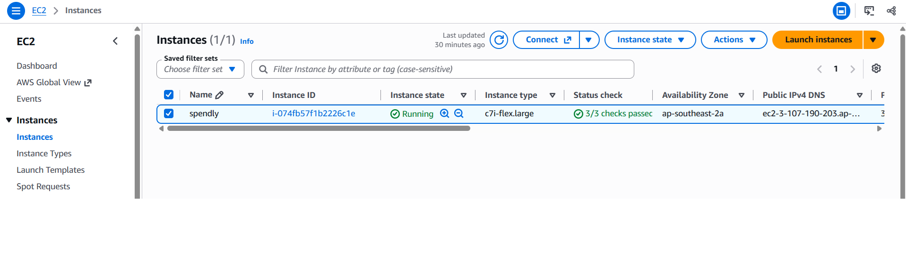

### 📱 Live on a phone (over mobile data)

<p align="center">
  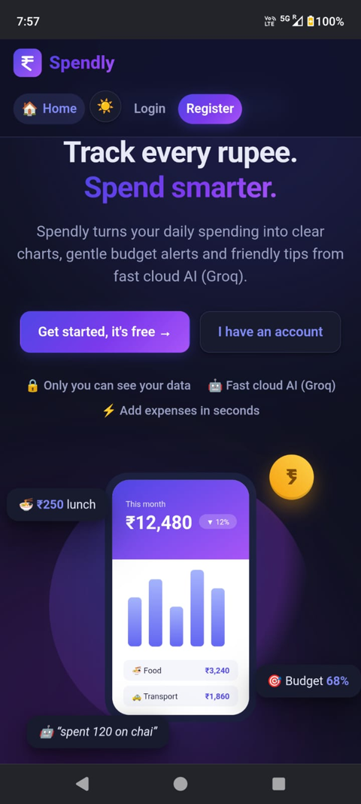
  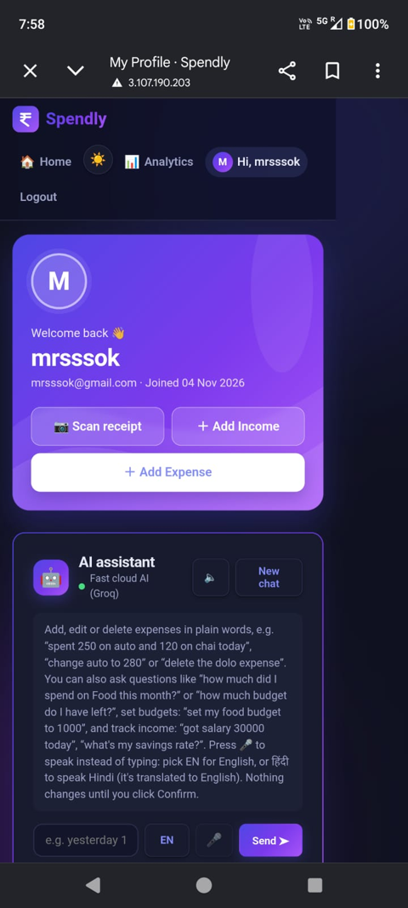
  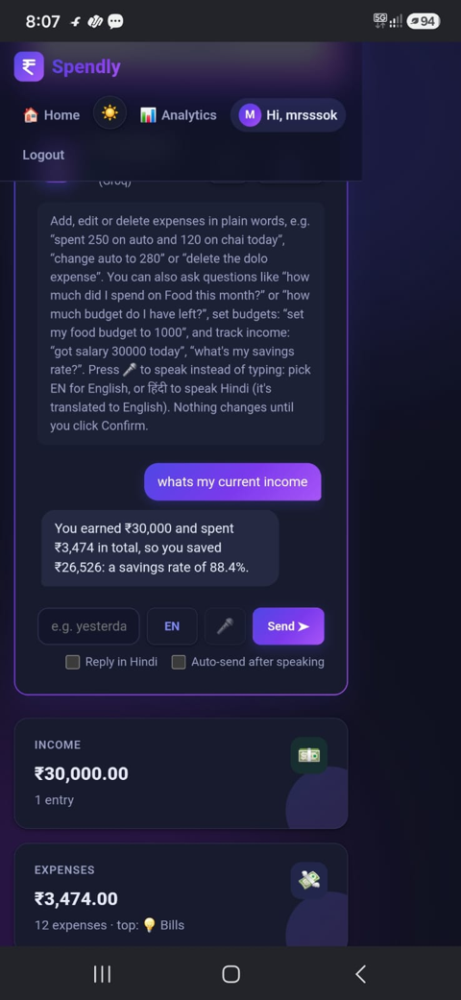
</p>

---

## 🧪 Tests and evals

```bash
pytest -q                                   # unit/integration tests (AI is mocked)
python evals/run_evals.py                   # full AI eval with the real model
python evals/run_evals.py --group actions   # one group
python evals/run_evals.py --only-failures   # re-run the last failures
python evals/ml_eval.py                     # forecast backtest + anomaly precision/recall
```

---

## 📁 Key files

```
app.py              routes and pages
config.py           all settings from environment variables
database/db.py      database access
ai_agent.py         LangChain/LangGraph assistant, tools, guardrails, provider switch
ai_insights.py      LangGraph insights workflow with output checks
forecast.py         month-end forecast
anomaly.py          anomaly detection
vision.py           OpenCV + vision LLM receipt reading
mcp_server.py       MCP server for Claude
evals/              eval harness, cases and ML eval
tests/              pytest suite
Dockerfile, docker-compose.yml
.github/workflows/ci.yml
```

---

## 📝 What I learned

- Building LLM agents with tools and memory, and keeping them safe with code-level guardrails
- Why evaluation matters: the eval harness caught silent wrong numbers and regressions that unit tests missed
- Comparing models on *my* task rather than general benchmarks
- Classic ML alongside LLMs, with honest baselines and backtesting
- Containerising and deploying a full-stack AI app, and handling cloud limits and costs

---

## ⚠️ Notes

- The live demo runs on plain HTTP; HTTPS with a domain is planned. Don't reuse real passwords on it.
- With `LLM_PROVIDER=groq`, messages and receipt images are sent to Groq for processing.
- Eval and ML results above were measured on my own test sets and synthetic data.
